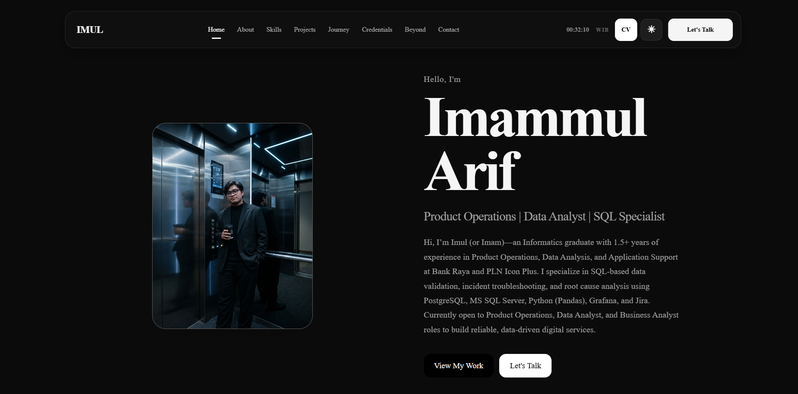

# Imammul_arf. — Personal Portfolio

A personal portfolio showcasing my **professional journey, technical skills, projects, and interests in Data & Technology**.

🌐 **Live Website:**  
https://imammularif.github.io/portfolio-V2.0/

---

## ✨ About

Hi, I'm **Imammul Arif**.

I'm an Informatics graduate with professional experience in **Product Operations, Digital Banking Operations, Incident Management, Application Support, SQL, and Data Validation**.

My professional interests focus on **Data Analytics, Product Operations, SQL & Database Management, and Data Engineering**. I continuously develop my technical capabilities through hands-on projects, professional experience, and independent learning.

This portfolio serves as a platform to showcase my **technical skills, projects, educational background, professional experience, and continuous development in technology**.

---

## 🚀 Features

- Responsive design
- Clean and minimal interface
- Light / Dark mode
- Smooth scrolling
- Scroll reveal animations
- Active navigation state
- Real-time WIB clock
- Responsive mobile navigation
- Project showcase
- Skills and tools section
- Education and professional journey timeline
- Contact section
- Custom favicon
- GitHub Pages deployment

---

## 📸 Screenshots

### ☀️ Light Mode


### 🌙 Dark Mode



---

## 🛠️ Built With

### Frontend Development

- HTML5
- CSS3
- JavaScript

### Data & Database Technologies

- SQL
- Python
- Pandas
- PostgreSQL
- Microsoft SQL Server
- Data Analytics
- Data Validation
- Database Troubleshooting

### Development & Productivity Tools

- Visual Studio Code
- Git
- GitHub
- DBeaver
- Grafana
- Microsoft Excel

### Deployment

- GitHub Pages

---

## 📂 Project Structure

```text
portfolio-V2.0/
│
├── index.html
├── index.css
├── favicon.png
│
├── IMG/
│   ├── me.jpg
│   ├── project-1.jpg
│   ├── project-2.jpg
│   └── ...
│
├── docs/
│   └── screenshots/
│       ├── portfolio-light.png
│       └── portfolio-dark.png
│
└── README.md
```

---

## 📌 Featured Projects

### 1. Smart Attendance with Face Recognition

A university final project focused on developing an attendance system using face recognition technology.

**Technologies:**
- Python
- OpenCV
- LBPH
- Face Recognition

### 2. Student Assessment Website

A web-based student assessment system developed as part of my university internship project. The application helps manage and present student assessment data in a structured digital environment.

**Technologies:**
- HTML
- CSS
- Web Development
- Database

---

## 🎓 Education & Professional Journey

My journey began with my early education in **Dompu**, continued through my Informatics studies at **Universitas Teknologi Yogyakarta**, and developed further through professional experience in Jakarta.

### Education

- **SD Negeri 1 Dompu**
- **SMP Negeri 1 Dompu**
- **SMA Negeri 1 Dompu — Science 1**
- **Universitas Teknologi Yogyakarta — Informatics**

### Professional Journey

- **PLN Icon Plus — Technical Support**
- **Independent Learning & Technical Upskilling**
- **Bank Raya Indonesia — Product Operations / Digital Problem Management**
- **Current Direction — Product Operations, Data Analytics & SQL**

---

## 📊 Professional Focus

I'm interested in professional opportunities and projects related to:

- Product Operations
- Data Analytics
- Data Operations
- SQL & Database Management
- Business Analysis
- Digital Banking Technology
- Application Support
- Data Engineering
- Cloud Technology
- AI / Machine Learning

---

## 📚 Continuous Learning

I believe continuous learning and practical experience are essential for professional growth.

I'm continuously developing my technical capabilities through independent learning, hands-on projects, and exploration of new technologies.

Current learning areas include:

- Advanced SQL
- Python for Data Analytics
- Data Analytics & Visualization
- Data Engineering Fundamentals
- Database Management
- Cloud Technology
- Data Science
- Machine Learning
- Generative AI

---

## 📫 Contact

If you'd like to connect, discuss a project, or explore professional opportunities, feel free to reach out.

**Email:**  
[imammularif@gmail.com](mailto:imammularif@gmail.com)

**Portfolio:**  
https://imammularif.github.io/portfolio-V2.0/

---

## 📄 License

This portfolio is a personal project created and maintained by **Imammul Arif**.

© 2026 Imammul Arif. All rights reserved.
