# IMAMMUL ARIF — PORTFOLIO V2.0

**Personal Portfolio Website | Product Operations · Data Analytics · SQL Specialist**

A personal portfolio website showcasing my professional identity, career journey, technical capabilities, projects, education, and continuous development in technology.

Portfolio V2.0 is a continuation of my first personal portfolio, [My Portfolio 1.0](https://github.com/imammularif/My-Portofolio-1.0), which I originally built from scratch using HTML5, CSS3, and Vanilla JavaScript.

As I continued learning and gaining professional experience, I realized that my previous portfolio still had room for improvement. Although it established the foundation of my personal digital presence, I wanted a platform that could better represent my professional growth, technical capabilities, projects, and evolving career direction.

That is why I started Portfolio V2.0 — not to leave my previous work behind, but to build upon it. This version represents my effort to strengthen the overall presentation, improve the user experience, refine the responsive interface, and create a more complete representation of my professional journey.

For me, Portfolio V2.0 is more than a website redesign. It is a continuation of what I started, a reflection of what I have learned, and a commitment to keep improving both my work and myself as a technology professional.

---

## 1. Project Overview

**Imammul Arif — Portfolio V2.0** is a personal portfolio website developed to present my professional background, work experience, technical skills, and project documentation.

The website is designed to provide an accessible and organized overview of my professional journey, with a focus on:

- Professional Profile
- Career Journey
- Technical Skills
- Featured Projects
- Education & Credentials
- Professional Interests
- Contact Information

**Project Version:** V2.0  
**Project Status:** Existing Website — UI/UX Refinement & Documentation

**Live Website:**  
https://imammularif.github.io/portfolio-V2.0/

**Repository:**  
https://github.com/imammularif/portfolio-V2.0

---

## 2. Product Vision

Develop and maintain a professional digital portfolio that presents my background and capabilities through a clear, structured, and consistent experience across desktop, tablet, and mobile devices.

### Design Principles

- Professional and minimalistic interface.
- Clear typography and visual hierarchy.
- Consistent visual identity.
- Responsive layouts across different screen sizes.
- Intuitive navigation and user interaction.
- Structured presentation of projects and professional information.
- Maintainable and lightweight implementation.

### Design Direction

| Platform | Design Direction |
|---|---|
| Desktop | Professional Interface with Light & Dark Themes |
| Tablet | Responsive Adaptive Layout |
| Mobile | Mobile-Friendly Navigation with Organized Sections |

---

## 3. UI/UX Design Documentation

This section documents the current visual interface of Portfolio V2.0 across desktop, mobile, and tablet devices. The screenshots serve as visual references for interface evaluation and future improvements.

### 3.1 Desktop Interface

The desktop documentation presents both available themes side by side for visual comparison.

<table>
  <tr>
    <td width="50%" align="center">
      <strong>Light Mode</strong><br><br>
      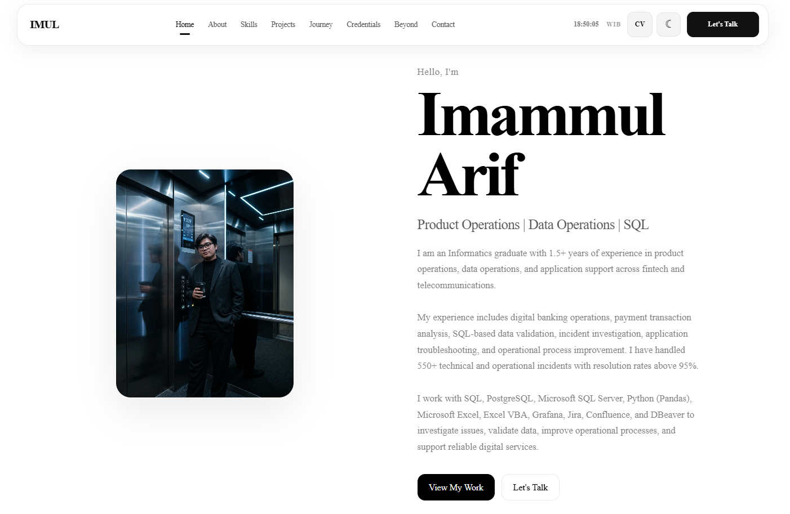
    </td>
    <td width="50%" align="center">
      <strong>Dark Night Mode</strong><br><br>
      
    </td>
  </tr>
</table>

### 3.2 Mobile Interface

Mobile screenshots document the main website sections and provide visual references for mobile navigation, content organization, and responsive improvements.

<table>
  <tr>
    <td width="20%" align="center"><strong>Home</strong><br><br>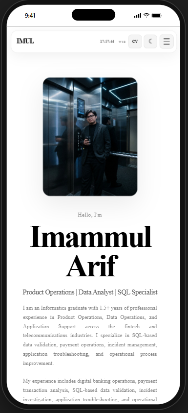</td>
    <td width="20%" align="center"><strong>About Me</strong><br><br>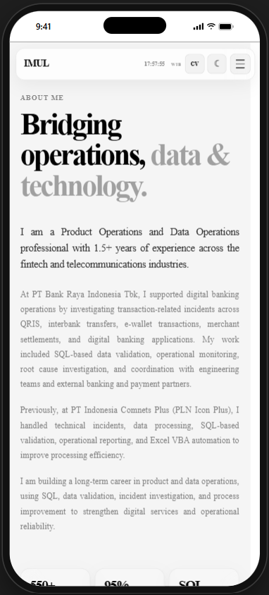</td>
    <td width="20%" align="center"><strong>Career</strong><br><br>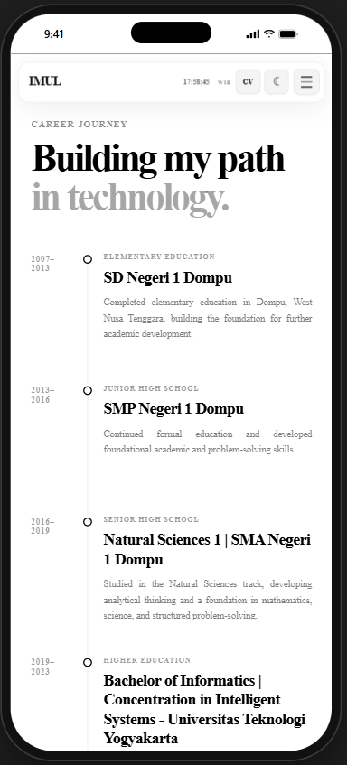</td>
    <td width="20%" align="center"><strong>Projects</strong><br><br></td>
    <td width="20%" align="center"><strong>Credentials</strong><br><br></td>
  </tr>
  <tr>
    <td width="20%" align="center"><strong>Core</strong><br><br></td>
    <td width="20%" align="center"><strong>Beyond</strong><br><br></td>
    <td width="20%" align="center"><strong>Footer</strong><br><br></td>
    <td width="20%" align="center"><strong>Hamburger Menu</strong><br><br>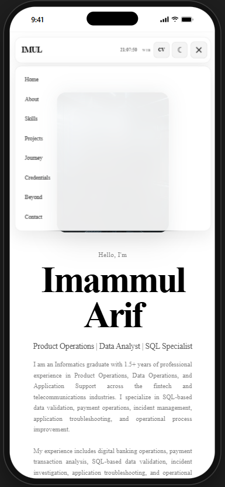</td>
    <td width="20%"></td>
  </tr>
</table>

### 3.3 Tablet Interface

Tablet screenshots document the main website sections and provide visual references for the adaptive interface and future responsive improvements.

<div align="center">

| **Home** | **About Me** | **Career** | **Projects** |
|:---:|:---:|:---:|:---:|
| 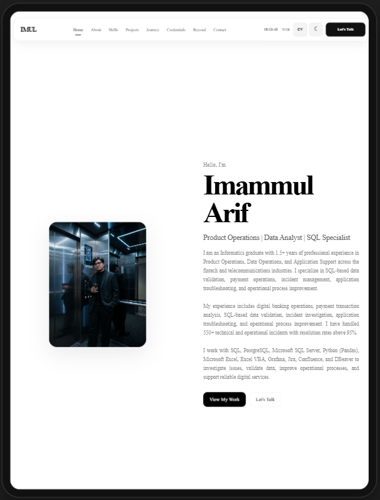 | 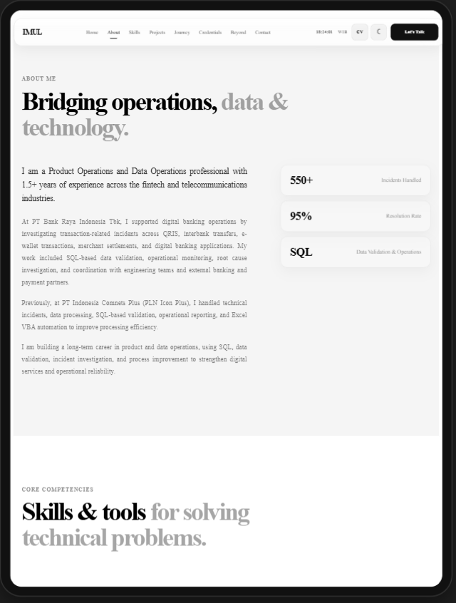 | 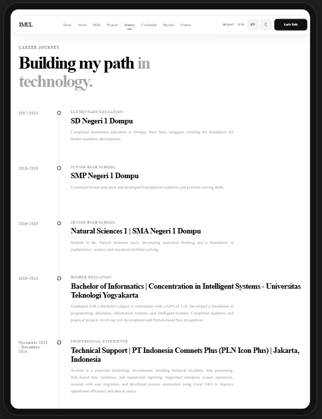 | 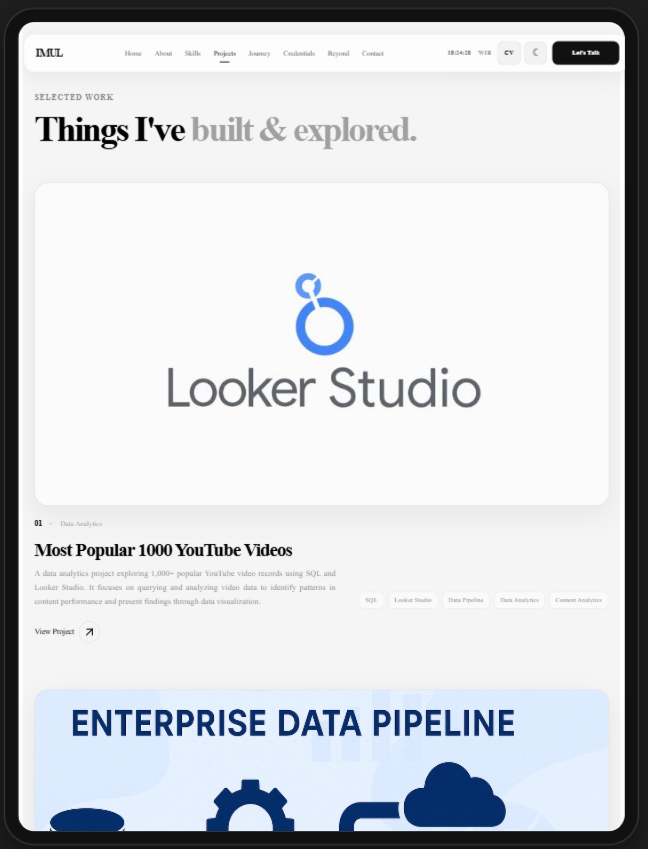 |
| **Credentials** | **Core** | **Beyond** | **Footer** |
| 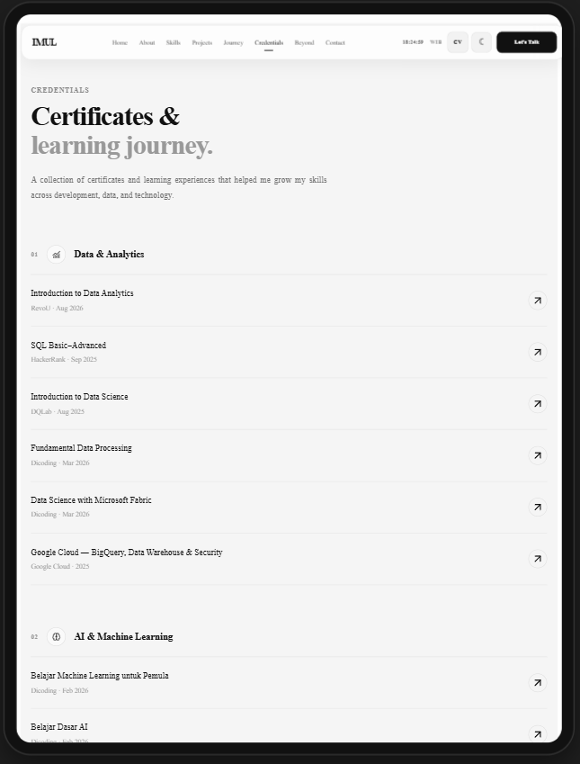 | 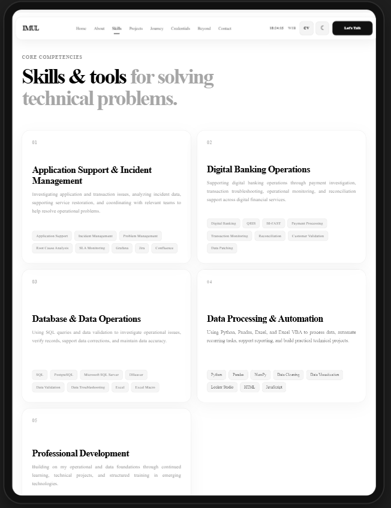 | 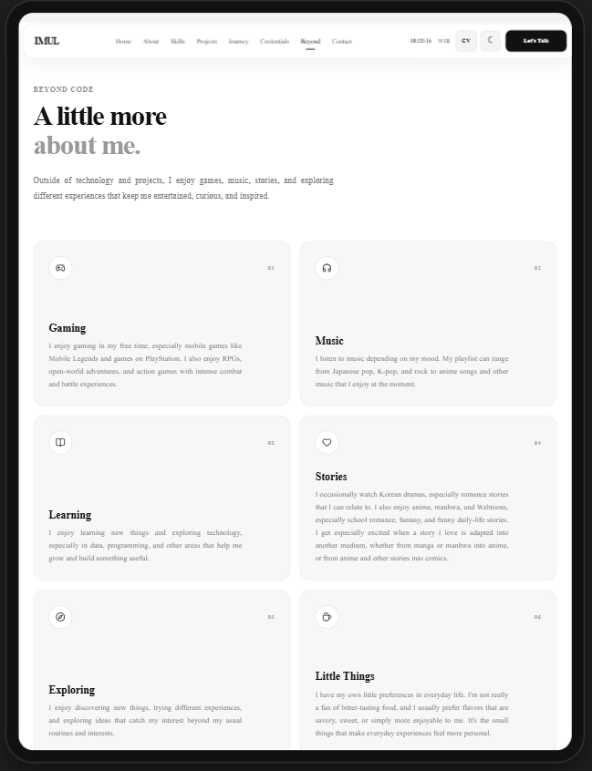 | 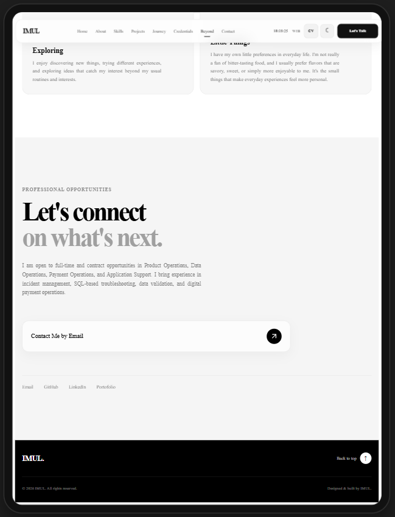 |

</div>

### 3.4 Responsive Development

Future improvements will focus on:

- Consistent navigation across desktop, tablet, and mobile.
- Better content spacing and readability.
- Responsive project and experience presentation.
- Optimized mobile navigation and interactions.
- Consistent visual behavior across supported themes.
- Improved accessibility and usability.

---

## 4. Features & Functionalities

Portfolio V2.0 currently includes:

- Personal Profile Presentation
- Professional Experience
- Education Background
- Technical Skills Showcase
- Featured Projects
- Credentials & Achievements
- Light and Dark Mode
- Responsive Navigation
- Real-Time WIB Clock
- Active Navigation State
- Scroll Reveal Animations
- Contact Information

Features will be reviewed, refined, and improved progressively as part of the ongoing development process.

---

## 5. Technology Stack

The portfolio uses a lightweight frontend stack:

| Technology | Purpose |
|---|---|
| HTML5 | Website structure |
| CSS3 | Styling, layout, and responsive design |
| Vanilla JavaScript | Interactions and dynamic functionality |
| Git & GitHub | Version control and repository management |
| GitHub Pages | Website hosting and deployment |

No frontend framework is required.

---

## 6. Project Structure

```text
portfolio-V2.0/
│
├── index.html
├── index.css
├── script.js
├── README.md
├── CV_IMAMMUL_ARIF_2026.pdf
│
├── IMG/
│   ├── me.jpeg
│   ├── favicon_io.zip
│   ├── favicon_io/
│   │   ├── android-chrome-192x192.png
│   │   ├── android-chrome-512x512.png
│   │   ├── apple-touch-icon.png
│   │   ├── favicon-16x16.png
│   │   ├── favicon-32x32.png
│   │   ├── favicon.ico
│   │   └── site.webmanifest
│   │
│   └── PROJECT/
│       ├── 01.png
│       ├── 02.png
│       └── ...
│
└── docs/
    ├── portfolio-light.png
    ├── portfolio-dark.png
    │
    ├── phone/
    │   ├── home.png
    │   ├── aboutme.png
    │   ├── career.png
    │   ├── projectwork.png
    │   ├── credential.png
    │   ├── core.png
    │   ├── beyond.png
    │   ├── footer.png
    │   ├── light.png
    │   └── dark.png
    │
    └── tablet/
        ├── home.png
        ├── about.png
        ├── career.png
        ├── projectwork.png
        ├── credential.png
        ├── core.png
        ├── beyond.png
        ├── footer.png
        ├── light.png
        └── dark.png
```

---

## 7. Installation & Usage

### Clone the Repository

```bash
git clone https://github.com/imammularif/portfolio-V2.0.git
```

### Navigate to the Project Directory

```bash
cd portfolio-V2.0
```

### Run the Website

Open `index.html` directly in your browser or use a local development server.

No frontend framework or additional package installation is required.

---

## 8. Contact

For professional opportunities, collaboration, or project discussions:

**Email:**  
imammularif@gmail.com

**Portfolio:**  
https://imammularif.github.io/portfolio-V2.0/

**GitHub:**  
https://github.com/imammularif

---

## 9. License

This portfolio is a personal project created and maintained by **Imammul Arif**.

© 2026 Imammul Arif. All rights reserved.
