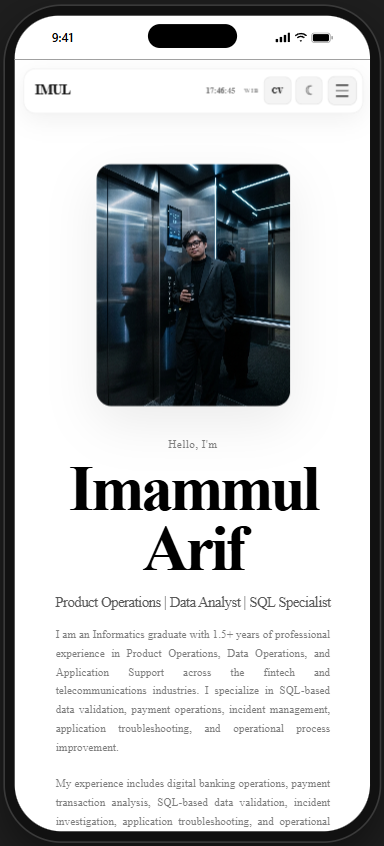
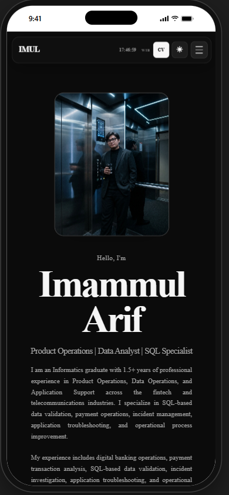
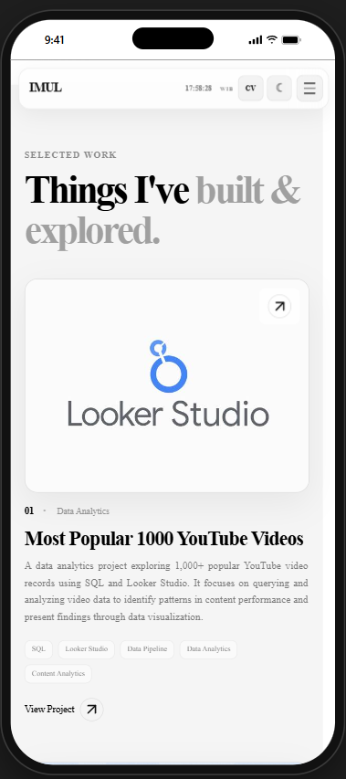
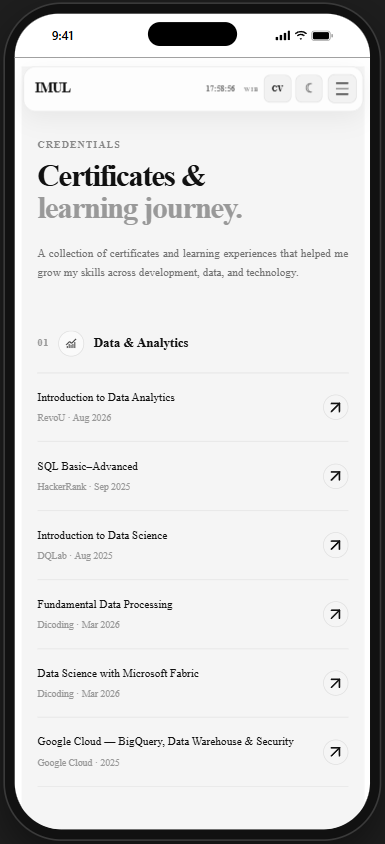
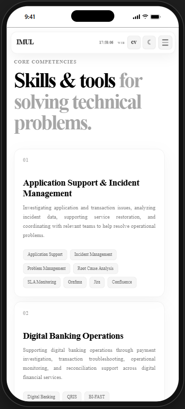
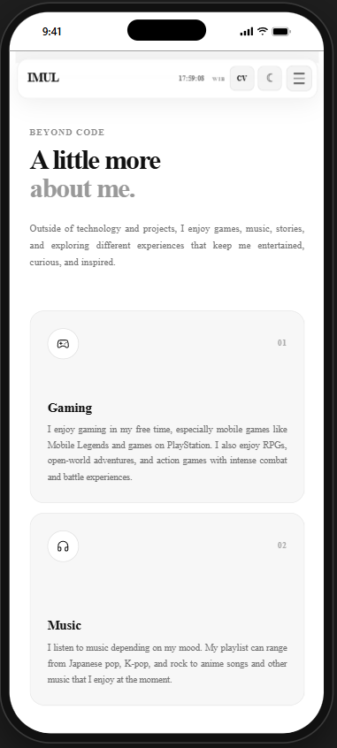
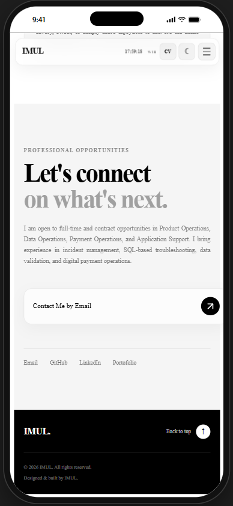

# IMAMMUL ARIF — PERSONAL PORTFOLIO

**Professional Portfolio Platform | Product Operations · Data Analytics · SQL Specialist**

A personal digital portfolio documenting my professional journey, technical capabilities, work experience, projects, and continuous development in technology.

This platform serves as a centralized place to explore my professional profile, career background, technical expertise, and practical projects.

---

## 1. Project Overview

**Imammul Arif — Personal Portfolio** is a personal portfolio website designed to present professional identity, experience, technical capabilities, and project documentation in a structured and accessible digital environment.

The platform focuses on:

- Professional Profile
- Career Journey
- Technical Skills
- Featured Projects
- Credentials & Education
- Professional Interests
- Contact Information

**Project Status:** Existing Portfolio — Redesign & Documentation Phase

**Live Website:**  
https://imammularif.github.io/portfolio-V2.0/

**Repository:**  
https://github.com/imammularif/portfolio-V2.0

---

## 2. Product Vision

Develop a professional digital portfolio that provides a clear, structured, and consistent experience across desktop, tablet, and mobile devices.

### Design Principles

- Professional and minimalistic interface.
- Dark Night visual experience for desktop.
- Consistent typography and visual hierarchy.
- Responsive layouts across different screen sizes.
- Intuitive navigation and user interaction.
- Structured project presentation and documentation.

### Design Direction

| Platform | Design Direction |
|---|---|
| Desktop | Dark Night Theme |
| Tablet | Responsive Adaptive Layout |
| Mobile | Mobile Navigation with Organized Sections |

---

## 3. UI/UX Design Documentation

This section documents the existing visual interface and responsive behavior of the portfolio. Screenshots serve as references for the upcoming redesign.

### 3.1 Desktop Interface

The desktop documentation presents both available themes side by side for easier visual comparison.

<table>
  <tr>
    <td width="50%" align="center">
      <strong>Light Mode</strong><br><br>
      
    </td>
    <td width="50%" align="center">
      <strong>Dark Night Mode</strong><br><br>
      
    </td>
  </tr>
</table>

### 3.2 Mobile Interface

Mobile screenshots document the existing interface and provide visual references for future navigation and responsive improvements.

<table>
  <tr>
    <td width="50%" align="center">
      <strong>Light Mode</strong><br><br>
      
    </td>
    <td width="50%" align="center">
      <strong>Dark Night Mode</strong><br><br>
      
    </td>
  </tr>
</table>


<div align="center">

<table>
  <tr>
    <td align="center"><strong>Home</strong></td>
    <td align="center"><strong>About Me</strong></td>
    <td align="center"><strong>Career</strong></td>
    <td align="center"><strong>Projects</strong></td>
  </tr>
  <tr>
    <td align="center"></td>
    <td align="center"></td>
    <td align="center"></td>
    <td align="center"></td>
  </tr>
  <tr>
    <td align="center"><strong>Credentials</strong></td>
    <td align="center"><strong>Core</strong></td>
    <td align="center"><strong>Beyond</strong></td>
    <td align="center"><strong>Footer</strong></td>
  </tr>
  <tr>
    <td align="center"></td>
    <td align="center"></td>
    <td align="center"></td>
    <td align="center"></td>
  </tr>
</table>

</div>


### 3.3 Tablet Interface

The tablet screenshot documents the current adaptive layout and serves as a reference for responsive improvements.

<p align="center">
  
</p>

<p align="center">
  <sub>Current Tablet Interface</sub>
</p>

### 3.4 Responsive Development

Future improvements will focus on:

- Consistent navigation across devices.
- Better content spacing and readability.
- Responsive project presentation.
- Optimized mobile navigation.
- Consistent light and dark theme behavior.

---

## 4. Features & Functionalities

The existing portfolio includes:

- Personal Profile Presentation
- Professional Experience
- Education Background
- Technical Skills Showcase
- Featured Projects
- Credentials & Achievements
- Light and Dark Mode
- Responsive Navigation
- Real-Time WIB Clock
- Active Navigation State
- Scroll Reveal Animations
- Contact Information

Features will be reviewed and improved progressively during the redesign process.

---

## 5. Technology Stack

### Frontend Development

- HTML5
- CSS3
- JavaScript (Vanilla JavaScript)

### Data & Database Technologies

- SQL
- Python
- Pandas
- PostgreSQL
- Microsoft SQL Server
- Data Analytics
- Data Validation
- Database Troubleshooting

### Development & Productivity Tools

- Visual Studio Code
- Git
- GitHub
- DBeaver
- Grafana
- Microsoft Excel

### Deployment

- GitHub Pages

---

## 6. Featured Projects

### 6.1 Smart Attendance System

A university final project focused on developing an attendance system using face recognition technology.

**Technologies:**

- Python
- OpenCV
- LBPH
- Face Recognition

### 6.2 Student Assessment Website

A web-based student assessment system developed as part of a university internship project.

The application helps manage and present student assessment data in a structured digital environment.

**Technologies:**

- HTML
- CSS
- JavaScript
- Database

### 6.3 YouTube Analytics Dashboard

A data analytics project focused on exploring and visualizing YouTube-related data.

**Technologies:**

- Data Analytics
- Looker Studio
- Data Visualization

### 6.4 ETL Data Pipeline

A practical project exploring data extraction, transformation, and loading processes.

**Technologies:**

- Python
- SQL
- Data Processing

### 6.5 TOPUPKU

A personal web application project focused on digital game top-up services.

**Technologies:**

- Next.js
- TypeScript
- Supabase
- Resend

---

## 7. Education & Professional Journey

### Education

- SD Negeri 1 Dompu
- SMP Negeri 1 Dompu
- SMA Negeri 1 Dompu — Science
- Universitas Teknologi Yogyakarta — Bachelor of Informatics

### Professional Experience

**PLN Icon Plus — Technical Support**

Technical support experience involving troubleshooting and operational support.

**Bank Raya Indonesia — Product Operations / Digital Problem Management**

Experience supporting digital banking operations, incident management, payment services, and data validation.

### Professional Direction

**Product Operations | Data Analyst | SQL Specialist**

---

## 8. Professional Focus

Areas of professional interest:

- Product Operations
- Data Analytics
- Data Operations
- SQL & Database Management
- Business Analysis
- Digital Banking Technology
- Application Support
- Data Engineering
- Cloud Technology
- AI & Machine Learning

---

## 9. Continuous Learning

Current learning areas include:

- Advanced SQL
- Python for Data Analytics
- Data Analytics & Visualization
- Data Engineering Fundamentals
- Database Management
- Cloud Technology
- Data Science
- Machine Learning
- Generative AI

---

## 10. Project Structure

```text
portfolio-V2.0/
│
├── index.html
├── index.css
├── script.js
├── README.md
├── CV_IMAMMUL_ARIF_2026.pdf
│
├── IMG/
│   ├── me.jpeg
│   ├── favicon_io.zip
│   ├── favicon_io/
│   │   ├── android-chrome-192x192.png
│   │   ├── android-chrome-512x512.png
│   │   ├── apple-touch-icon.png
│   │   ├── favicon-16x16.png
│   │   ├── favicon-32x32.png
│   │   ├── favicon.ico
│   │   └── site.webmanifest
│   │
│   └── PROJECT/
│       ├── 01.png
│       ├── 02.png
│       └── ...
│
└── docs/
    ├── portfolio-light.png
    ├── portfolio-dark.png
    │
    ├── phone/
    │   ├── home.png
    │   ├── aboutme.png
    │   ├── career.png
    │   ├── projectwork.png
    │   ├── credential.png
    │   ├── core.png
    │   ├── beyond.png
    │   ├── footer.png
    │   ├── light.png
    │   └── dark.png
    │
    └── tablet/
        └── Screenshot 2026-11-23 174838.png
```

---

## 11. Installation & Usage

Clone the repository:

```bash
git clone https://github.com/imammularif/portfolio-V2.0.git
```

Navigate to the project directory:

```bash
cd portfolio-V2.0
```

Run the website using a local development server or open `index.html` in your browser.

No frontend framework installation is required.

---

## 14. Contact

For professional opportunities, collaboration, or project discussions:

**Email:**  
imammularif@gmail.com

**Portfolio:**  
https://imammularif.github.io/portfolio-V2.0/

**GitHub:**  
https://github.com/imammularif

---

## 15. License

This portfolio is a personal project created and maintained by **Imammul Arif**.

© 2026 Imammul Arif. All rights reserved.
